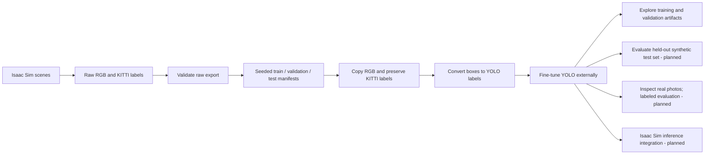

# Isaac Sim Pallet-Jack Perception

An end-to-end research project for generating synthetic pallet-jack images in NVIDIA Isaac Sim, preparing them for object detection, fine-tuning an Ultralytics YOLO model outside the simulator, and eventually evaluating and deploying that detector.

The repository keeps the work in distinct stages: simulator-based synthetic data generation, reproducible dataset preparation, external model training, visual and quantitative evaluation, and a planned path back to Isaac Sim for inference.

## At a glance

- **Task:** detect the `palletjack` object and return its image bounding box.
- **Synthetic source data:** 5,000 independent Isaac Sim scenes across three conditions.
- **Dataset splits:** 4,000 train, 500 validation, and 500 held-out test images (80/10/10, seed 42).
- **Baseline:** fine-tuned Ultralytics YOLO26n, 100 epochs, 640-pixel model input, batch size 16.
- **Current state:** data validation and preparation, training, prediction visualization, and an interactive results notebook are available. The plots below report validation performance only.
- **Not yet complete:** held-out test evaluation, a labeled real-image benchmark, and Isaac Sim inference integration.

## What the pipeline does



The simulator creates the source data; training runs in a normal Python environment with PyTorch and Ultralytics. This separation keeps the training workflow repeatable without requiring Isaac Sim to be open while a model is being trained.

## Baseline results

The current baseline used `yolo26n.pt`, seed 42, 100 epochs, a 640 input size, and batch size 16. The selected checkpoint is `best.pt`, chosen using validation mAP50-95. In this run, its best validation mAP50-95 was **0.79183 at epoch 89**. At that epoch, validation precision was **0.93125**, recall **0.82429**, and mAP50 **0.90984**.

These are measurements on the 500-image **validation split**. The 500-image test split has not yet been evaluated, so these figures should not be presented as final or held-out test performance. The plots are checked-in snapshots so they render on GitHub; the complete run files and checkpoints remain local under the ignored `runs/` directory.

### Training losses and validation metrics

This training summary shows box, classification, and localization losses for train and validation data, alongside validation precision, recall, mAP50, and mAP50-95 by epoch. Loss decreasing while validation metrics improve is consistent with learning; the held-out test set is still needed for a final synthetic benchmark.


### Precision-recall curve

The curve summarizes the precision/recall tradeoff as the confidence threshold varies. For a single class, the chart reports pallet-jack average precision; the displayed AP at IoU 0.50 is not the same as mAP50-95.


### Confusion matrix

The raw matrix contains counts, while the normalized matrix expresses the counts as proportions. In an object detector, the background row/column helps show missed objects and detections without a matching labeled object. Read the axis labels as well as the cells: this plot is based on validation predictions and its normalization is performed by Ultralytics.


<details>
<summary>Raw validation confusion matrix (counts)</summary>


</details>

### Example validation images

The label montage shows the expected annotations; the prediction montage shows what the model predicted for those same validation examples. These images are a qualitative sample, not an independent accuracy measurement.

| Ground-truth boxes | Model predictions |
| --- | --- |
|  |  |

## Dataset and annotation format

The local raw export contains these three scenario groups:

| Scenario | Frames | Labeled objects | Empty annotations |
| --- | ---: | ---: | ---: |
| `distractors_additional` | 2,000 | 5,017 | 259 |
| `distractors_warehouse` | 2,000 | 5,826 | 190 |
| `no_distractors` | 1,000 | 3,242 | 65 |
| **Total** | **5,000** | **14,085** | **514** |

Images are reported as 960x544. The raw folders contain RGB, object-detection labels, depth, instance segmentation, and semantic outputs. The current detector pipeline uses only RGB images and KITTI-style `object_detection` labels. It preserves original KITTI labels in the processed tree and writes YOLO labels alongside them; depth and segmentation outputs stay in the raw tree.

The converter reads the paired image dimensions and maps the 2D KITTI bounding box to a normalized YOLO row (`class_id center_x center_y width height`). `palletjack` is class `0`. The current KITTI maximum-edge interpretation is an inclusive-pixel working assumption; see [data preparation notes](docs/data.md) for the validation rules and this unresolved convention.

The split is randomized reproducibly within each scenario. Since these frames represent independent scenes, the current first experiment uses an 80/10/10 allocation per scenario:

| Scenario | Train | Validation | Test |
| --- | ---: | ---: | ---: |
| `distractors_additional` | 1,600 | 200 | 200 |
| `distractors_warehouse` | 1,600 | 200 | 200 |
| `no_distractors` | 800 | 100 | 100 |
| **Total** | **4,000** | **500** | **500** |

## Get started

### Requirements

- Git and Python 3.10 or newer.
- The raw Isaac Sim export in `data/raw/` to run the data pipeline.
- A PyTorch build matching your hardware. For CUDA training, use the current command from the [official PyTorch install selector](https://pytorch.org/get-started/locally/); CUDA-enabled PyTorch bundles the CUDA runtime components it needs, while the installed NVIDIA driver must support it.
- Project packages listed in `requirements.txt` (Pillow, PyYAML, Ultralytics, Matplotlib, JupyterLab, and IPython kernel support).

From Git Bash on Windows, create and activate the virtual environment, install the hardware-matched PyTorch build, then install project requirements:

```bash
python -m venv .venv
source .venv/Scripts/activate
python -m pip install --upgrade pip
# Install the correct PyTorch build for your CPU/GPU using pytorch.org/get-started/locally
python -m pip install -r requirements.txt
```

Check that the active interpreter is the virtual environment's Python with `which python` and `python --version`. See [training setup](docs/training.md) for GPU notes, dependency details, preflight, and run configuration.

### 1. Validate the raw export

The validator checks the raw RGB/annotation pairs, image readability, class names, annotation fields, and 2D box geometry. It is read-only; empty annotations are allowed as negative frames.

```bash
python scripts/validate_dataset.py --root data/raw
```

The current export passed validation with no issues. See [data workflow](docs/data.md) for the detailed report and what the validator does not check.

### 2. Create split manifests

This step assigns every raw frame to exactly one split and writes CSV manifests. It does not copy image files or convert labels.

```bash
python scripts/create_splits.py
```

Defaults are 80/10/10 and seed 42. Existing manifests are not silently replaced; pass `--overwrite` when intentionally regenerating them.

### 3. Process raw data into the YOLO dataset

Run this after creating the manifests. It copies only the selected RGB images and KITTI labels, converts those copied labels to YOLO format, and writes `data/processed/dataset.yaml`.

```bash
python scripts/process_raw_data.py
```

The processing step preserves raw inputs and keeps the original KITTI labels under `data/processed/kitti_labels/`. It writes images under `data/processed/images/` and YOLO annotations under `data/processed/labels/`. For a deliberate rerun over generated outputs, use `--overwrite`. See [data workflow](docs/data.md) for the full layout and options.

### 4. Preflight and train

Edit `configs/train_yolo.yaml` for the initial checkpoint, dataset YAML, epochs, input size, batch size, device, seed, workers, and run name. The starter values are 100 epochs, 640 input size, batch 16, seed 42, and automatic device selection.

First validate the configuration without loading a model or starting training:

```bash
python scripts/train_yolo.py --config configs/train_yolo.yaml --validate-only
```

Then launch training:

```bash
python scripts/train_yolo.py --config configs/train_yolo.yaml
```

Ultralytics fine-tunes the configured pretrained detector on `images/train`, monitors `images/val`, and writes checkpoints, `results.csv`, plots, and run metadata under `runs/detect/<name>/`. It selects `best.pt` from validation performance and also saves `last.pt`. Use a new run name for each experiment; existing output directories are protected against accidental overwrite.

### 5. Explore training results

The interactive notebook reads a selected run from `runs/detect/`, plots training losses and validation metrics, and displays the PR curve, confusion matrices, and validation examples:

```bash
python -m ipykernel install --user --name palletjack-detection --display-name "Python (Pallet Jack Detection)"
jupyter lab notebooks/01_explore_training_results.ipynb
```

Choose the `Python (Pallet Jack Detection)` kernel in Jupyter if needed. Update `RUN_NAME` in the first code cell to inspect another experiment. Optional real-photo inference and training-launch cells are off by default and require explicit opt-in. More details are in [training setup](docs/training.md).

### 6. Visualize predictions on images

Use this command on a single image or a folder. The source images remain unchanged; annotated copies go to the output folder. This is visual inspection only and does not compute accuracy for unlabeled photos.

```bash
python scripts/predict_real_images.py \
  --source local/real-images \
  --model runs/detect/palletjack-detection-yolo26n-seed42/weights/best.pt \
  --output runs/predictions/real-photos
```

Add photos to the local `local/real-images/` folder. It is gitignored. For confidence, input-size, device, and output behavior, see [evaluation notes](docs/evaluation.md).

## Model evaluation: what is and is not measured

Training curves, PR curves, confusion matrices, and the displayed image montages above come from the validation split, which is used during training and checkpoint selection. They are useful for development, but they are not a final estimate of generalization.

The next evaluation stage is to run the selected checkpoint once on the untouched 500-image synthetic test split and record the checkpoint, dataset version, thresholds, and metrics. Separately, a labeled real-photo dataset is needed to compute real-image precision, recall, and mAP; unlabeled photos support visual review only. Compare synthetic and real metrics only after both sets have ground-truth boxes and are evaluated consistently. Isaac Sim integration and simulator-side performance checks come after that.

See [evaluation notes](docs/evaluation.md) and [Isaac Sim integration notes](docs/isaac-sim-integration.md) for the planned work and reporting guidance.

## Repository layout and what belongs in Git

```text
configs/                    Training and dataset configuration
data/raw/                   Local Isaac Sim exports (ignored)
data/processed/             Local splits, copied images, labels (ignored)
docs/                       Workflow documentation and README figures
local/                      Machine-local inputs and scratch data (ignored)
models/                     Model weights (ignored)
notebooks/                  Interactive training-results exploration
runs/                       Training and prediction outputs (ignored)
scripts/                    Command-line entry points
simulation/                 Isaac Sim synthetic-data resources and scripts
src/palletjack_detection/   Reusable validation, processing, training, and inference code
tests/                      Automated regression tests
```

Commit source code, configuration templates, documentation, and the small baseline figures in `docs/assets/baseline/`. Do not commit the raw/processed datasets, training runs, prediction outputs, local images, virtual environment, or model checkpoints; these are excluded by `.gitignore`. The README figures are intentional lightweight snapshots of a baseline run, not the full run artifacts.

Run the repository test suite from the project root with:

```bash
python -m unittest discover -s tests -v
```

## Detailed documentation

- [Data preparation and dataset details](docs/data.md)
- [Training configuration and Jupyter notebook](docs/training.md)
- [Prediction visualization and evaluation plan](docs/evaluation.md)
- [Isaac Sim integration notes](docs/isaac-sim-integration.md)
