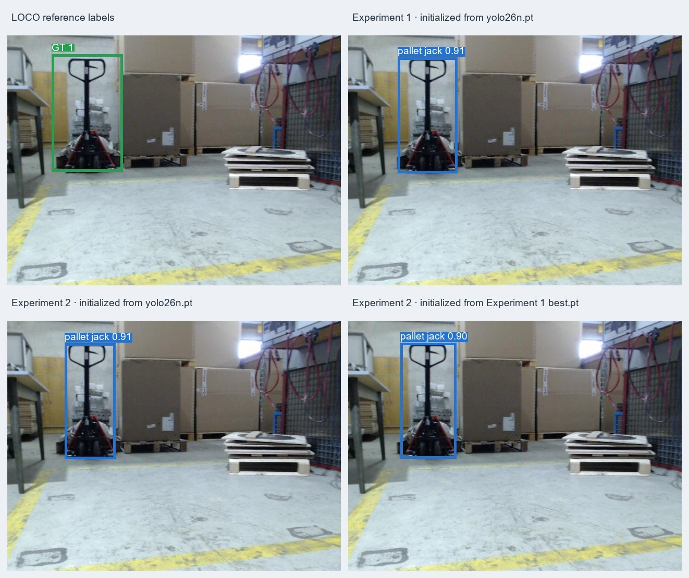
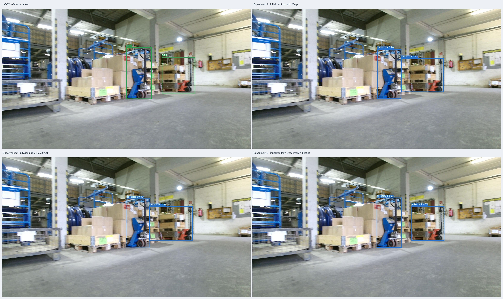
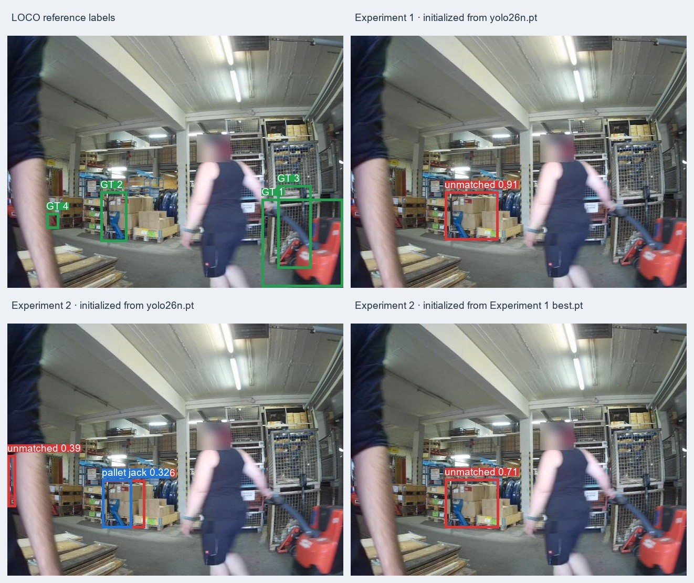

# Isaac Sim Pallet-Jack Detection

An experimental pipeline for generating automatically labeled pallet-jack images in NVIDIA Isaac Sim, fine-tuning an Ultralytics YOLO detector, and measuring its performance on synthetic and real warehouse images.

## Abstract

This project studies whether synthetic pallet-jack scenes can support object-detector training and how well a detector transfers to real images. Experiment 1 established a YOLO26n baseline trained on 5,000 Isaac Sim frames. Experiment 2 added a powered electric pallet truck and a forklift stacker, both labeled positive under the original broad interpretation. The current target includes **manual and electric pallet trucks**, while forklift stackers are hard negatives. Experiment 2 is therefore a historical run with stackers incorrectly labeled as positives. Experiment 3 is configured to add target-free hard-negative scenes with stackers. Existing LOCO subset-1 results are diagnostic: its `pallet_truck` annotations do not distinguish pallet-truck variants from stackers, so labels need subtype review before metrics can be treated as definitive for the current target.

## 1. Research question

Can independently randomized scenes rendered in Isaac Sim provide useful training data for a detector of manual and electric pallet trucks, and how do hard negatives such as forklift stackers affect performance?

The intended detector is a one-class object detector for manual and electric pallet trucks, both labeled `pallet-jack`. Given an image, it returns bounding boxes, class IDs, and confidence scores. It does not classify images into “pallet jack” versus “none”; images without an in-scope truck are negative examples with no boxes. Forklift stackers are out of scope and are useful hard negatives.

## 2. Synthetic data generation

The generator starts from Isaac Sim's Simple Warehouse scene and uses Replicator to randomize scene state per rendered frame. It varies camera pose, pallet-jack placement and rotation, lighting, and floor and wall materials. The three conditions differ by distractors: warehouse props, props from additional asset groups, or no added distractor group. All use the same base warehouse.

Replicator exports 960×544 RGB images and KITTI-style 2D object-detection labels, along with other modalities retained in the raw export. The detector uses RGB and 2D boxes only. Frames are independently randomized scene states, not adjacent frames from a video. Automatic annotation is structurally validated, but does not guarantee visual correctness for every box.

| Experiment | Synthetic source | Curation and assets |
|---|---|---|
| **1 — baseline** | 5,000 frames: 2,000 warehouse distractors, 2,000 additional distractors, 1,000 no added distractors | Original NVIDIA pallet-jack asset mix |
| **2 — expanded assets (historical label scope)** | 4,824 retained frames across the same three conditions | Two local USDZ assets (powered electric pallet truck and forklift stacker) were labeled positive; 176 transparent-black RGB frames and paired labels removed, and three zero-width annotation rows removed |
| **3 — expanded collection (configured, not yet generated)** | Planned 6,000 frames under `data/raw/experiment-03/`: 5,000 target-positive frames across three conditions and 1,000 target-free hard negatives | Current target policy: manual and electric pallet trucks are positive; stackers and the other local USDZ props are unlabeled distractors. The hard-negative group uses eight sampled props plus one stacker per frame; empty object labels expected |

The raw exports, simulator requirements, randomization settings, and cleanup details are documented in the [simulation guide](simulation/README.md) and the [Experiment 1](docs/experiments/experiment-01.md) and [Experiment 2](docs/experiments/experiment-02.md) records. For Experiment 3, one `generate_data.bat` or `generate_data.sh` run creates all four groups under `data/raw/experiment-03/`; the output still needs to be generated and visually checked.

| Warehouse distractors | Additional distractors | No added distractors |
|---|---|---|
|  |  |  |

[Scene-generation walkthrough video](docs/assets/sdg/SDG_sample0.mov)

## 3. Dataset preparation and split design

Raw synthetic labels are validated, assigned to train/validation/test manifests, copied with their RGB images, and converted from KITTI to normalized YOLO labels. The original KITTI labels are preserved in the processed tree. Each experiment has separate raw and processed directories. Splits are stratified within the three generation conditions using seed `42` and an 80/10/10 ratio.

| Experiment | Train | Validation | Held-out test | Test boxes |
|---|---:|---:|---:|---:|
| 1 | 4,000 | 500 | 500 | 1,427 |
| 2 | 3,859 | 483 | 482 | 2,307 |

For real-image evaluation, the project uses [LOCO (Logistics Objects in Context)](https://github.com/tum-fml/loco), an annotated logistics-scene dataset. The current adapter retains 1,075 COCO-listed images from subset-1 and filters the broad `pallet_truck` category, producing 594 boxes in 403 images. LOCO does not distinguish manual and electric pallet trucks from stackers in that category, so those 594 boxes are **not yet verified ground truth for the current target**. The prior LOCO metrics must be read as measurements against the broad LOCO category, not definitive pallet-truck accuracy. An additional 65 JPGs without COCO image records are excluded because their labels are unknown. COCO boxes are converted to YOLO format only as an adapter for the existing Ultralytics evaluator; the COCO annotations remain the source labels.

The same processed LOCO adapter is reused for all three model evaluations. LOCO subset-1 is officially a validation subset; it is not an independent test set for this project.

## 4. Models and evaluation protocol

All models use YOLO26n, a 640-pixel training input, batch size 16, 100 epochs, seed `42`, and four data workers. Source frames are 960×544; Ultralytics resizes them for model input while preserving aspect ratio. The checkpoints were trained on CUDA using an NVIDIA GeForce RTX 5080 Laptop GPU. Validation metrics select `best.pt` by mAP50–95; held-out synthetic test evaluation is run separately after training.

| Model | Training data | Initialization |
|---|---|---|
| Experiment 1 baseline | Experiment 1 | `yolo26n.pt` |
| Experiment 2 pretrained | Experiment 2 | `yolo26n.pt` |
| Experiment 2 continued | Experiment 2 | Experiment 1 `best.pt` |

The Experiment 2 comparison tests two initialization choices on the same Experiment 2 data and split. It is not an ablation of individual simulator randomization settings. The Experiment 1 and Experiment 2 synthetic test sets come from different generated datasets, so scores across those two test sets are not a controlled head-to-head comparison.

| Model | Best validation epoch | Validation mAP50–95 |
|---|---:|---:|
| Experiment 1 baseline | 89 | 0.7918 |
| Experiment 2 pretrained | 84 | 0.7242 |
| Experiment 2 continued from Experiment 1 | 82 | 0.7264 |

## 5. Results

### 5.1 Held-out synthetic test performance

| Model | Test images | Test boxes | Precision | Recall | mAP50 | mAP50–95 |
|---|---:|---:|---:|---:|---:|---:|
| Experiment 1 baseline | 500 | 1,427 | 0.9248 | 0.8087 | 0.9059 | 0.7861 |
| Experiment 2 pretrained | 482 | 2,307 | 0.9132 | 0.7847 | 0.8845 | 0.7380 |
| Experiment 2 continued from Experiment 1 | 482 | 2,307 | 0.9108 | 0.7850 | 0.8795 | 0.7369 |

Precision measures the fraction of predicted boxes that match a labeled object; recall measures the fraction of labeled objects found. mAP50 evaluates average precision at IoU 0.50, while mAP50–95 averages it across IoU thresholds from 0.50 to 0.95, rewarding tighter localization.

The two Experiment 2 models are nearly tied on their shared test set: mAP50–95 differs by 0.0011. Initializing from Experiment 1 did not improve the Experiment 2 score in this run. These results show strong performance on the generated distributions; they do not establish real-world performance.

### 5.2 LOCO subset-1 diagnostic

All three checkpoints were evaluated on the same LOCO images and annotations.

| Model | Precision | Recall | mAP50 | mAP50–95 |
|---|---:|---:|---:|---:|
| Experiment 1 baseline | 0.4113 | 0.1768 | 0.1430 | 0.0600 |
| Experiment 2 pretrained | 0.3797 | 0.2828 | 0.2147 | 0.0830 |
| Experiment 2 continued from Experiment 1 | 0.3947 | 0.2525 | 0.2239 | 0.0850 |

Compared with Experiment 1, both Experiment 2 models have higher recall and mAP, but lower precision. Their real-image scores remain weak: recall is 0.25–0.28 and mAP50–95 is below 0.09. These measurements support further investigation of the expanded asset mix, but do not prove it caused the change.

### 5.3 Fixed-threshold per-image audit

To make the aggregate LOCO scores easier to interpret, predictions were matched to COCO-derived boxes at confidence `0.25` and IoU `0.50`, using one-to-one matching. These counts describe that fixed operating point; they are not the same as the aggregate Ultralytics metrics, which use the evaluator's own threshold selection and average-precision procedure.

| Model | Matched boxes | Missed labeled boxes | Unmatched predictions | Positive images with misses | Positive images fully missed | Negative images with a prediction |
|---|---:|---:|---:|---:|---:|---:|
| Experiment 2 pretrained | 224 | 370 / 594 | 849 | 286 / 403 | 209 / 403 | 269 / 672 |
| Experiment 2 continued from Experiment 1 | 174 | 420 / 594 | 424 | 318 / 403 | 255 / 403 | 185 / 672 |

At this threshold, the pretrained Experiment 2 model matches more labeled boxes and also generates many more unmatched predictions. A prediction in an image with no recorded target box is not necessarily a confirmed false positive: LOCO annotations have not been comprehensively checked, so some apparent errors could be annotation omissions. The local audit gallery is generated rather than committed; in this workspace, it is at `local/annotation_audit/experiment-02-loco-predictions/index.html`.

### 5.4 Qualitative comparison across scene difficulty

Each comparison image shows the LOCO reference labels and all three models' predictions on the same scene. The panels progress from a clear single object to a crowded, occluded scene. Click a thumbnail for the full-size comparison.

<table>
  <tr>
    <td align="center"> <b>Straightforward</b> All models detect the target.</td>
    <td align="center"> <b>More complex</b> Two targets among warehouse equipment.</td>
    <td align="center"> <b>Difficult</b> People and equipment obscure targets.</td>
  </tr>
</table>

These selected scenes illustrate failure modes; they are not a representative sample of aggregate performance. Displayed predictions use confidence ≥ 0.25 and are matched at IoU ≥ 0.50.

## 6. Interpretation, limitations, and next work

The real-image error audit suggested limited hard-negative coverage may contribute to false detections, but the LOCO labels do not separate in-scope pallet trucks from stackers. The earlier audit counts and metrics therefore cannot establish current-target false-positive or false-negative rates. Experiment 3 is configured to recollect all three positive-scene conditions with the current asset mix and add target-free scenes with stackers; all its output must be reviewed and processed before any new training comparison.

Interpret these results with the following limits in mind:

- **LOCO is a development diagnostic.** Its subset-1 is officially a validation subset, and the observed appearance/scale gap informed Experiment 2. It is not an untouched final benchmark.
- **LOCO labels do not fully match the current target scope.** The broad `pallet_truck` category may include stackers, so its old metrics are diagnostic until images and boxes are reviewed for equipment subtype.
- **Synthetic test sets differ.** The Experiment 1 and Experiment 2 test results measure different generated distributions and should not be read as a controlled experiment-to-experiment comparison.
- **One training seed per configuration.** The small Experiment 2 initialization difference may reflect run variation; repeated seeds and a controlled ablation are needed to establish a reliable effect.
- **Deployment is not evaluated.** No inference integration, runtime benchmark, or real-system validation in Isaac Sim has been completed.

Next, generate and review all Experiment 3 positive and hard-negative groups, audit LOCO labels to separate pallet trucks from stackers, then process and train a controlled comparison. Reserve an independent real-image holdout and repeat training/evaluation with multiple seeds before drawing transfer conclusions.

## 7. Reproducibility and project materials

Full run artifacts and checkpoints are local and gitignored. Dataset preparation, configuration, and commands are documented in the [data guide](docs/data.md), [training guide](docs/training.md), and [evaluation guide](docs/evaluation.md). The two interactive notebooks are [`data_processing.ipynb`](notebooks/data_processing.ipynb) and [`explore_training_results.ipynb`](notebooks/explore_training_results.ipynb). Experiment-specific counts, validation curves, test artifacts, and run paths are in the [Experiment 1 record](docs/experiments/experiment-01.md) and [Experiment 2 record](docs/experiments/experiment-02.md).

The LOCO dataset is described by Mayershofer, Holm, Molter, and Fottner, [“LOCO: Logistics Objects in Context,” ICMLA 2020](https://mediatum.ub.tum.de/doc/1578845/document.pdf); the project and dataset details are available in the [official LOCO repository](https://github.com/tum-fml/loco). Additional provenance and licensing notes are in [docs/data.md](docs/data.md).
