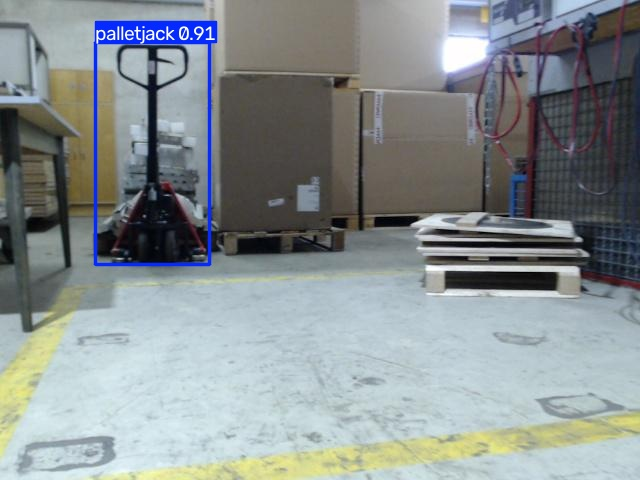
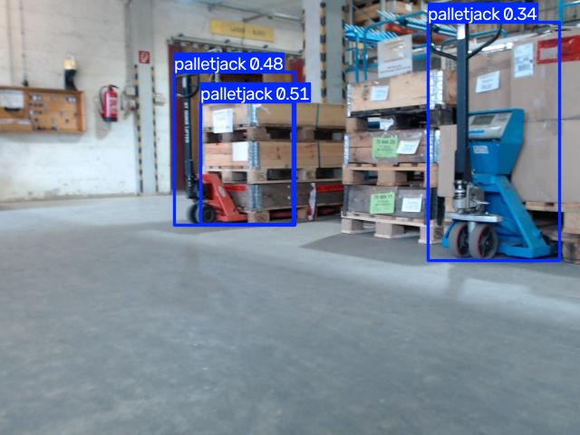
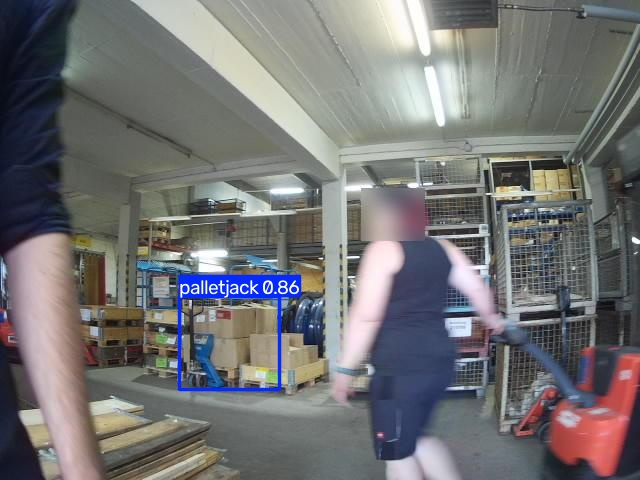
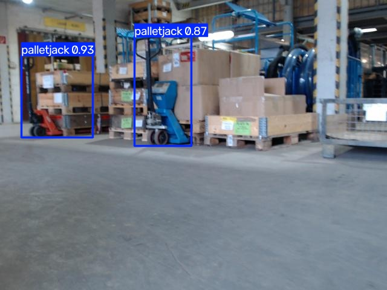

# Isaac Sim Pallet-Jack Detection

<table>
  <tr>
    <td align="center"> <b>Experiment 1 · baseline</b> One manual pallet jack detected.</td>
    <td align="center"> <b>Experiment 2 · expanded assets</b> Three predictions in a cluttered multi-truck scene.</td>
  </tr>
  <tr>
    <td align="center"> <b>Experiment 3 · hard negatives</b> One detection in a heavily occluded scene; several labeled objects are missed.</td>
    <td align="center"> <b>Experiment 4 · combined data</b> Two pallet-jack detections among stacked goods.</td>
  </tr>
</table>

*Each image is a separate LOCO subset-1 scene annotated by that experiment's pretrained checkpoint (confidence threshold 0.25). These selected examples illustrate model outputs, not aggregate performance. LOCO's broad `pallet_truck` labels may include stackers outside the project's current target definition.*

An experimental pipeline for generating automatically labeled pallet-jack images in NVIDIA Isaac Sim, fine-tuning an Ultralytics YOLO detector, and measuring its performance on synthetic and real warehouse images.

## Abstract

This project studies whether synthetic pallet-jack scenes can support object-detector training and how well a detector transfers to real images. Experiment 1 established a YOLO26n baseline trained on 5,000 Isaac Sim frames. Experiment 2 added a powered electric pallet truck and a forklift stacker, both labeled positive under the original broad interpretation. The current target includes **manual and electric pallet trucks**, while forklift stackers are out of scope and serve as hard negatives. Experiment 3 collected new positive scenes under the current target policy and target-free hard-negative scenes containing stackers and other warehouse props. Experiment 4 is a controlled comparison of pretrained versus randomly initialized YOLO26n using the existing Experiment 1 and 3 datasets, with no additional simulation collection. LOCO subset-1 remains a diagnostic because its `pallet_truck` annotations do not distinguish pallet-truck variants from stackers.

## 1. Research question

Can independently randomized scenes rendered in Isaac Sim provide useful training data for a detector of manual and electric pallet trucks, and how do hard negatives such as forklift stackers affect performance?

The intended detector is a one-class object detector for manual and electric pallet trucks, both labeled `pallet-jack`. Given an image, it returns bounding boxes, class IDs, and confidence scores. It does not classify images into “pallet jack” versus “none”; images without an in-scope truck are negative examples with no boxes. Forklift stackers are out of scope and are useful hard negatives.

## 2. Synthetic data generation

The generator starts from Isaac Sim's Simple Warehouse scene and uses Replicator to randomize scene state per rendered frame. It varies camera pose, pallet-jack placement and rotation, lighting, and floor and wall materials. The three conditions differ by distractors: warehouse props, props from additional asset groups, or no added distractor group. All use the same base warehouse.

Replicator exports 960×544 RGB images and KITTI-style 2D object-detection labels, along with other modalities retained in the raw export. The detector uses RGB and 2D boxes only. Frames are independently randomized scene states, not adjacent frames from a video. Automatic annotation is structurally validated, but does not guarantee visual correctness for every box.

| Experiment | Synthetic source | Curation and assets |
|---|---|---|
| **1 — baseline** | 5,000 frames: 2,000 warehouse distractors, 2,000 additional distractors, 1,000 no added distractors | Original NVIDIA pallet-jack asset mix |
| **2 — expanded assets (historical label scope)** | 4,824 retained frames across the same three conditions | Two local USDZ assets (powered electric pallet truck and forklift stacker) were labeled positive; 176 transparent-black RGB frames and paired labels removed, and three zero-width annotation rows removed |
| **3 — current target and hard negatives (raw collection complete)** | 6,000 generated frames; 5,762 retained after removing 238 invalid black RGB frames and paired labels | Manual and electric pallet trucks are positive in three conditions; 908 retained target-free frames contain warehouse props, local distractors, and the stacker |
| **4 — initialization comparison (trained and evaluated)** | Reuses Experiment 1 and 3 processed splits; no new simulator run | Compares `yolo26n.pt` fine-tuning with `yolo26n.yaml` random initialization; Experiment 2 excluded because its stacker boxes conflict with the current label policy |

The raw exports, simulator requirements, randomization settings, and cleanup details are documented in the [simulation guide](simulation/README.md) and the [Experiment 1](docs/experiments/experiment-01.md), [Experiment 2](docs/experiments/experiment-02.md), and [Experiment 3](docs/experiments/experiment-03.md) records. Experiment 4 reuses existing processed data and requires no simulator run; its paired training setup is described in the [Experiment 4 record](docs/experiments/experiment-04.md).

| Warehouse distractors | Additional distractors | No added distractors |
|---|---|---|
|  |  |  |

[Scene-generation walkthrough video](docs/assets/sdg/SDG_sample0.mov)

## 3. Dataset preparation and split design

Raw synthetic labels are validated, assigned to train/validation/test manifests, copied with their RGB images, and converted from KITTI to normalized YOLO labels. The original KITTI labels are preserved in the processed tree. Each experiment has separate raw and processed directories. Splits are stratified within the three generation conditions using seed `42` and an 80/10/10 ratio.

| Experiment | Train | Validation | Held-out test | Test boxes |
|---|---:|---:|---:|---:|
| 1 | 4,000 | 500 | 500 | 1,427 |
| 2 | 3,859 | 483 | 482 | 2,307 |
| 3 | 4,608 | 577 | 577 | 1,453 |
| 4 | 8,608 | 1,077 | 1,077 | 2,880 |

For real-image evaluation, the project uses [LOCO (Logistics Objects in Context)](https://github.com/tum-fml/loco), an annotated logistics-scene dataset. The current adapter retains 1,075 COCO-listed images from subset-1 and filters the broad `pallet_truck` category, producing 594 boxes in 403 images. A visual spot-check suggests the boxes generally surround material-handling equipment, but LOCO does not distinguish manual and electric pallet trucks from stackers. The boxes are therefore **not verified ground truth for the project's exact target definition**, and the LOCO metrics measure agreement with the broader category. An additional 65 JPGs without COCO image records are excluded because their labels are unknown. COCO boxes are converted to YOLO format only as an adapter for the existing Ultralytics evaluator; the COCO annotations remain the source labels.

The same processed LOCO adapter is reused for all six completed model evaluations. LOCO subset-1 is officially a validation subset; it is not an independent test set for this project.

## 4. Models and evaluation protocol

All models use YOLO26n, a 640-pixel training input, batch size 16, 100 epochs, seed `42`, and four data workers. Source frames are 960×544; Ultralytics resizes them for model input while preserving aspect ratio. The checkpoints were trained on CUDA using an NVIDIA GeForce RTX 5080 Laptop GPU. Validation metrics select `best.pt` by mAP50–95; held-out synthetic test evaluation is run separately after training.

| Model | Training data | Initialization |
|---|---|---|
| Experiment 1 baseline | Experiment 1 | `yolo26n.pt` |
| Experiment 2 pretrained | Experiment 2 | `yolo26n.pt` |
| Experiment 2 continued | Experiment 2 | Experiment 1 `best.pt` |
| Experiment 3 pretrained | Experiment 3 | `yolo26n.pt` |
| Experiment 4 pretrained | Experiments 1 + 3 | `yolo26n.pt` |
| Experiment 4 scratch | Experiments 1 + 3 | `yolo26n.yaml` (random initialization) |

Experiment 2 tests two initialization choices on the same Experiment 2 data and split. Experiment 4 compared pretrained and scratch initialization on the same combined Experiment 1 + 3 data and split. Experiment 2 is excluded from Experiment 4 because its stacker labels conflict with the current target definition. Cross-experiment scores remain descriptive, not controlled head-to-head comparisons.

| Model | Best validation epoch | Validation mAP50–95 |
|---|---:|---:|
| Experiment 1 baseline | 89 | 0.7918 |
| Experiment 2 pretrained | 84 | 0.7242 |
| Experiment 2 continued from Experiment 1 | 82 | 0.7264 |
| Experiment 3 pretrained | 83 | 0.6428 |
| Experiment 4 pretrained | 83 | 0.7385 |
| Experiment 4 scratch | 91 | 0.6939 |

## 5. Results

### 5.1 Held-out synthetic test performance

| Model | Test images | Test boxes | Precision | Recall | mAP50 | mAP50–95 |
|---|---:|---:|---:|---:|---:|---:|
| Experiment 1 baseline | 500 | 1,427 | 0.9248 | 0.8087 | 0.9059 | 0.7861 |
| Experiment 2 pretrained | 482 | 2,307 | 0.9132 | 0.7847 | 0.8845 | 0.7380 |
| Experiment 2 continued from Experiment 1 | 482 | 2,307 | 0.9108 | 0.7850 | 0.8795 | 0.7369 |
| Experiment 3 pretrained | 577 | 1,453 | 0.8538 | 0.7032 | 0.7875 | 0.6480 |
| Experiment 4 pretrained | 1,077 | 2,880 | 0.9090 | 0.7807 | 0.8672 | 0.7455 |
| Experiment 4 scratch | 1,077 | 2,880 | 0.8731 | 0.7432 | 0.8349 | 0.6919 |

Precision measures the fraction of predicted boxes that match a labeled object; recall measures the fraction of labeled objects found. mAP50 evaluates average precision at IoU 0.50, while mAP50–95 averages it across IoU thresholds from 0.50 to 0.95, rewarding tighter localization.

The two Experiment 2 models are nearly tied on their shared test set: mAP50–95 differs by 0.0011. In Experiment 4, the pretrained run exceeded the scratch run by 0.0536 mAP50–95 on their shared synthetic test split. Experiment 4 reuses the Experiment 1 and 3 test images, so comparisons with earlier experiments are descriptive rather than independent. Synthetic test performance does not establish real-world performance.

### 5.2 LOCO subset-1 diagnostic

All six trained checkpoints were evaluated on the same LOCO images and annotations.

| Model | Precision | Recall | mAP50 | mAP50–95 |
|---|---:|---:|---:|---:|
| Experiment 1 baseline | 0.4113 | 0.1768 | 0.1430 | 0.0600 |
| Experiment 2 pretrained | 0.3797 | 0.2828 | 0.2147 | 0.0830 |
| Experiment 2 continued from Experiment 1 | 0.3947 | 0.2525 | 0.2239 | 0.0850 |
| Experiment 3 pretrained | 0.4218 | 0.2391 | 0.2015 | 0.0642 |
| Experiment 4 pretrained | 0.5615 | 0.2350 | 0.2240 | 0.0848 |
| Experiment 4 scratch | 0.4630 | 0.1919 | 0.1635 | 0.0546 |

Experiment 4 pretrained has the highest precision in this diagnostic (0.5615), while its recall remains low (0.2350). Its mAP50–95 (0.0848) is close to the highest recorded value (0.0850 for Experiment 2 continued from Experiment 1). The Experiment 4 pretrained model exceeds its scratch counterpart on all four metrics, but the broad LOCO category can include out-of-scope stackers, so these scores are not verified measures of the project's target class.

### 5.3 Fixed-threshold per-image audit

To make the aggregate LOCO scores easier to interpret, predictions were matched to COCO-derived boxes at confidence `0.25` and IoU `0.50`, using one-to-one matching. These counts describe that fixed operating point; they are not the same as the aggregate Ultralytics metrics, which use the evaluator's own threshold selection and average-precision procedure.

| Model | Matched boxes | Missed labeled boxes | Unmatched predictions | Positive images with misses | Positive images fully missed | Negative images with a prediction |
|---|---:|---:|---:|---:|---:|---:|
| Experiment 2 pretrained | 224 | 370 / 594 | 849 | 286 / 403 | 209 / 403 | 269 / 672 |
| Experiment 2 continued from Experiment 1 | 174 | 420 / 594 | 424 | 318 / 403 | 255 / 403 | 185 / 672 |

At this threshold, the pretrained Experiment 2 model matches more labeled boxes and also generates many more unmatched predictions. A prediction in an image with no recorded target box is not necessarily a confirmed false positive: LOCO annotations have not been comprehensively checked, so some apparent errors could be annotation omissions. The local audit gallery is generated rather than committed; in this workspace, it is at `local/annotation_audit/experiment-02-loco-predictions/index.html`.

### 5.4 Qualitative comparison across scene difficulty

Each comparison image shows the LOCO reference labels and all three models' predictions on the same scene. The panels progress from a clear single object to a crowded, occluded scene. Click a thumbnail for the full-size comparison.

<table>
  <tr>
    <td align="center"> <b>Straightforward</b> All models detect the target.</td>
    <td align="center"> <b>More complex</b> Two targets among warehouse equipment.</td>
    <td align="center"> <b>Difficult</b> People and equipment obscure targets.</td>
  </tr>
</table>

These selected scenes illustrate failure modes; they are not a representative sample of aggregate performance. Displayed predictions use confidence ≥ 0.25 and are matched at IoU ≥ 0.50.

## 6. Interpretation, limitations, and next work

The real-image error audit suggested limited hard-negative coverage may contribute to false detections, but the LOCO labels do not separate in-scope pallet trucks from stackers. The earlier audit counts and metrics therefore cannot establish current-target false-positive or false-negative rates. Experiment 3 provides a processed dataset under the revised target scope and target-free hard negatives, and its model has been evaluated on the held-out synthetic split. The LOCO annotation ambiguity remains: the real-image metrics above use broad `pallet_truck` labels that can include stackers, so they cannot fully establish performance for Experiment 3’s target definition. One zero-width annotation was removed from `distractors_warehouse/Camera/object_detection/1727.txt`; synthetic labels still warrant visual review.

Interpret these results with the following limits in mind:

- **LOCO is a development diagnostic.** Its subset-1 is officially a validation subset, and the observed appearance/scale gap informed Experiment 2. It is not an untouched final benchmark.
- **LOCO labels do not fully match the current target scope.** A visual spot-check found boxes generally located on equipment, but the broad `pallet_truck` category may include stackers. The metrics remain diagnostic until the examples are reviewed and labeled by subtype.
- **Synthetic test sets differ.** Each experiment measures a different generated distribution and target-label policy; score changes across experiments are not controlled head-to-head comparisons.
- **One training seed per configuration.** The small Experiment 2 initialization difference may reflect run variation; repeated seeds and a controlled ablation are needed to establish a reliable effect.
- **Deployment is not evaluated.** No inference integration, runtime benchmark, or real-system validation in Isaac Sim has been completed.

Experiment 4 has now compared pretrained and scratch initialization on the same combined Experiment 1 + 3 data. The pretrained model scored higher on both the shared synthetic test split and the LOCO diagnostic. The synthetic split was evaluated in earlier experiments, so it is not an untouched project-level benchmark; LOCO boxes look generally plausible in the reviewed sample, but the broad category may include stackers and has not been fully subtype-audited. Detailed metrics and run paths are in the [Experiment 4 record](docs/experiments/experiment-04.md), with saved real-image samples in the local [annotation audit index](local/annotation_audit/index.html).

## 7. Reproducibility and project materials

Full run artifacts and checkpoints are local and gitignored. Dataset preparation, configuration, and commands are documented in the [data guide](docs/data.md), [training guide](docs/training.md), and [evaluation guide](docs/evaluation.md). The two interactive notebooks are [`data_processing.ipynb`](notebooks/data_processing.ipynb) and [`explore_training_results.ipynb`](notebooks/explore_training_results.ipynb). Experiment-specific counts, validation curves, test artifacts, and run paths are in the [Experiment 1](docs/experiments/experiment-01.md), [Experiment 2](docs/experiments/experiment-02.md), [Experiment 3](docs/experiments/experiment-03.md), and [Experiment 4](docs/experiments/experiment-04.md) records.

The LOCO dataset is described by Mayershofer, Holm, Molter, and Fottner, [“LOCO: Logistics Objects in Context,” ICMLA 2020](https://mediatum.ub.tum.de/doc/1578845/document.pdf); the project and dataset details are available in the [official LOCO repository](https://github.com/tum-fml/loco). Additional provenance and licensing notes are in [docs/data.md](docs/data.md).
