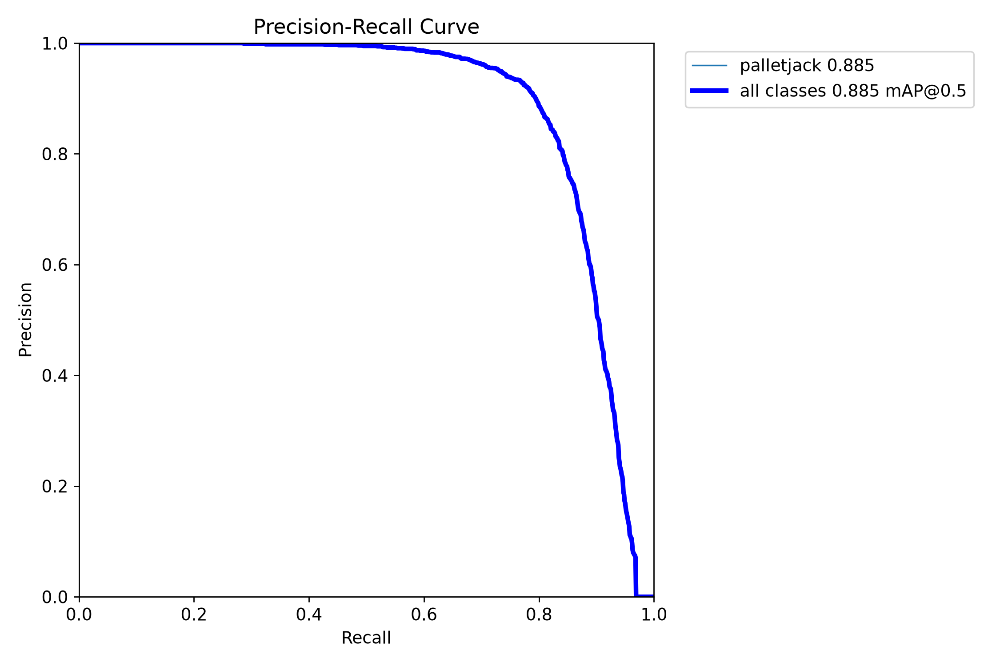
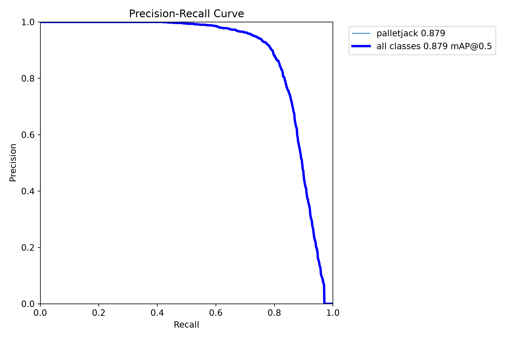
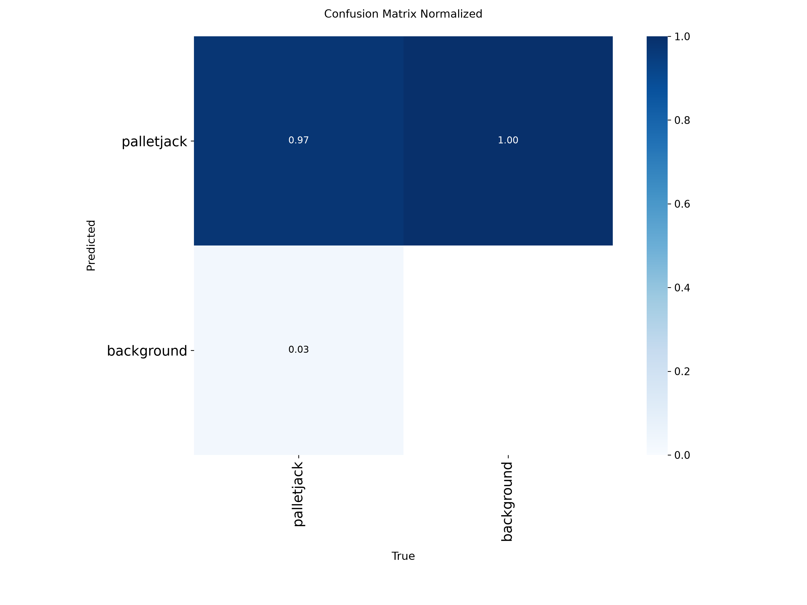

# Experiment 2 — Expanded Isaac Sim pallet-jack asset mix

## Purpose and status

**Experiment ID:** `EXP-002`  
**Status:** both training runs completed and were evaluated on the held-out Experiment 2 synthetic test split.

Experiment 2 investigates whether adding larger and visually different pallet-jack assets to the synthetic scene improves the model's ability to detect the pallet-jack appearances that were weakly detected in the separate LOCO real-image diagnostic. It preserves Experiment 1 as the baseline and gives all new raw data, processed data, and future model runs an experiment-specific location.

The LOCO results motivated this change, so LOCO is useful as a diagnostic during development. It must not be described as an untouched independent test set for this design iteration. A broader independently labeled real-world holdout is still needed for stronger transfer claims.

## What changed from Experiment 1

| Area | Experiment 1 (`EXP-001`) | Experiment 2 (`EXP-002`) |
|---|---|---|
| Synthetic assets | NVIDIA Isaac Sim pallet-jack asset | NVIDIA asset plus two local USDZ variants: `electric_pallet_jack.usdz` and `pallet_jack_advanced.usdz` |
| Local model appearance | Not applicable | Original imported materials are visible on some frames; randomized-color instances are used on others |
| Local asset scale | Not applicable | Fixed `1.9x` multiplier in the generator |
| Render settling | Earlier setting | `/omni/replicator/RTSubframes` set to `10` after intermittent transparent-black images were observed |
| Data roots | `data/raw/experiment-01/`, `data/processed/experiment-01/` | `data/raw/experiment-02/`, `data/processed/experiment-02/` |
| Model results | Completed baseline | Two completed 100-epoch runs; both evaluated on the same held-out test split |

The local USDZ files are machine-local and gitignored. Their assets are expected at `simulation/assets/pallet_jacks/experiment-02/`; users reproducing generation must supply the files themselves. The simulation implementation and settings are described in [`simulation/README.md`](../../simulation/README.md) and the generator at [`simulation/scripts/palletjack_sdg/standalone_palletjack_sdg.py`](../../simulation/scripts/palletjack_sdg/standalone_palletjack_sdg.py).

## Raw data cleanup and validation

Isaac Sim generated three independently randomized scenario collections. Increasing RTSubframes reduced—but did not eliminate—the invalid transparent-black renders. A content scan removed each exact fully transparent black RGB frame and its paired KITTI object-detection annotation:

| Scenario | Transparent-black RGB/label pairs removed |
|---|---:|
| `distractors_additional` | 59 |
| `distractors_warehouse` | 64 |
| `no_distractors` | 53 |
| **Total** | **176** |

The cleaned collection was then checked with the KITTI object-detection validator. Three zero-width box rows were removed from their annotation files while preserving their images and all remaining valid boxes: one row in `distractors_additional/Camera/object_detection/956.txt`, and one row each in `distractors_warehouse/Camera/object_detection/221.txt` and `821.txt`. The subsequent validation passed with no issues.

| Scenario | Clean images and annotation files | Valid pallet-jack objects | Empty annotations |
|---|---:|---:|---:|
| `distractors_additional` | 1,941 | 8,740 | 129 |
| `distractors_warehouse` | 1,936 | 9,587 | 118 |
| `no_distractors` | 947 | 5,017 | 54 |
| **Total** | **4,824** | **23,344** | **301** |

Empty annotations remain valid negative frames. The raw collection is curated: it excludes the 176 unusable transparent-black frames and omits the three degenerate zero-width annotation rows. Original KITTI annotation files otherwise remain in the raw tree. As in Experiment 1, structural validation does not verify visually that every retained box encloses the intended object.

## Processed dataset and split

The same seed `42` and 80/10/10 per-scenario policy used in Experiment 1 was applied to Experiment 2. All 4,824 frames are represented once in the manifests:

| Scenario | Train | Validation | Test |
|---|---:|---:|---:|
| `distractors_additional` | 1,553 | 194 | 194 |
| `distractors_warehouse` | 1,549 | 194 | 193 |
| `no_distractors` | 757 | 95 | 95 |
| **Total** | **3,859** | **483** | **482** |

Processed images, preserved KITTI labels, YOLO labels, split manifests, and dataset YAML are under `data/processed/experiment-02/`. These generated data are local and gitignored. The preprocessing and converter behavior are documented in [`docs/data.md`](../data.md).

The local ground-truth audit gallery is at `local/annotation_audit/experiment-02/index.html`; open `local/annotation_audit/index.html` for the experiment-separated landing page. It displays the stored YOLO boxes in green for all splits and scenarios, without running model inference or copying the source images. Regenerate it with `python scripts/build_annotation_audit.py` after the processed dataset changes.

## Training comparison

Two models were trained on the same Experiment 2 split and settings:

1. **Fresh pretrained initialization:** `yolo26n.pt`, using [`configs/train_yolo_e2_pretrained.yaml`](../../configs/train_yolo_e2_pretrained.yaml). Its run name is `palletjack-detection-yolo26n-pretrained-seed42`.
2. **Experiment 1 checkpoint initialization:** [`configs/train_yolo_e2_exp01-best.yaml`](../../configs/train_yolo_e2_exp01-best.yaml) initializes from `runs/detect/palletjack-detection-yolo26n-seed42/weights/best.pt` and writes to the distinct run `palletjack-detection-exp01-best-seed42`.

Both runs used 100 epochs, 640 input size, batch size 16, seed 42, four workers, and automatic device selection. Validation was run after each epoch; Ultralytics recorded per-epoch validation precision, recall, mAP50, and mAP50-95 in each run's `results.csv`. The selected `best.pt` checkpoint is from the epoch with the highest validation mAP50-95.

Both selected checkpoints were evaluated on the held-out Experiment 2 synthetic test split using the same evaluator, image size, batch, and CUDA device. The test split contains 482 images and 2,307 labeled pallet-jack instances. Full run artifacts remain under ignored `runs/detect/experiment-02/`; small report figures are checked in under `docs/assets/experiment-02/`.

## Experiment 2 results

### Validation during training

Validation was run at every epoch for both models. The table reports the best validation epoch, selected by mAP50-95, and the metrics recorded at that epoch. These validation results informed checkpoint selection; the held-out test set remained separate.

| Initialization | Best epoch | Precision | Recall | mAP50 | mAP50-95 |
|---|---:|---:|---:|---:|---:|
| `yolo26n.pt` | 84 | 0.9116 | 0.7809 | 0.8750 | 0.7242 |
| Experiment 1 `best.pt` | 82 | 0.9033 | 0.7849 | 0.8731 | 0.7264 |

### Held-out Experiment 2 synthetic test

The selected `best.pt` checkpoints were evaluated once on the same 482-image test split at 640 input size, batch 16, with CUDA device 0 (NVIDIA GeForce RTX 5080 Laptop GPU). There are 2,307 labeled pallet-jack boxes across the split.

| Initialization | Precision | Recall | mAP50 | mAP50-95 |
|---|---:|---:|---:|---:|
| `yolo26n.pt` | 0.9132 | 0.7847 | 0.8845 | 0.7380 |
| Experiment 1 `best.pt` | 0.9108 | 0.7850 | 0.8795 | 0.7369 |

The two test mAP50-95 values differ by about 0.0011. That small difference does not establish a meaningful advantage for either initialization. On this test split, initializing from the Experiment 1 checkpoint did not improve the score over training from `yolo26n.pt`; broader evaluation and repeated seeds would be needed to judge whether the difference is reproducible. These numbers measure performance on held-out synthetic frames from the Experiment 2 generator and labels, not real-world performance.

#### Precision-recall curves

#### Normalized confusion matrices

#### Test image examples

These are sample batches from the held-out test set, not manually selected best cases.

| Test labels | `yolo26n.pt` predictions | Experiment 1 `best.pt` predictions |
|---|---|---|
|  |  |  |

Reproduce the test runs with `scripts/evaluate_test_set.py` and the checkpoints named above, using `data/processed/experiment-02/dataset.yaml`. The saved `test_metrics.json` records the exact settings and metrics. The separate regression check on Experiment 1's test split remains a useful next evaluation before making claims about preserving performance on the original asset mix.

## Results

The `yolo26n.pt`-initialized run has been launched and has saved `best.pt` and `last.pt`; it has not yet completed all configured epochs or its held-out test evaluation. The Experiment 1-checkpoint-initialized run is configured separately and has not been launched. Add completed run details, test metrics, plots, qualitative findings, and deviations here after evaluation. Until then, Experiment 1 remains the only completed model result; see the [Experiment 1 record](experiment-01.md).
